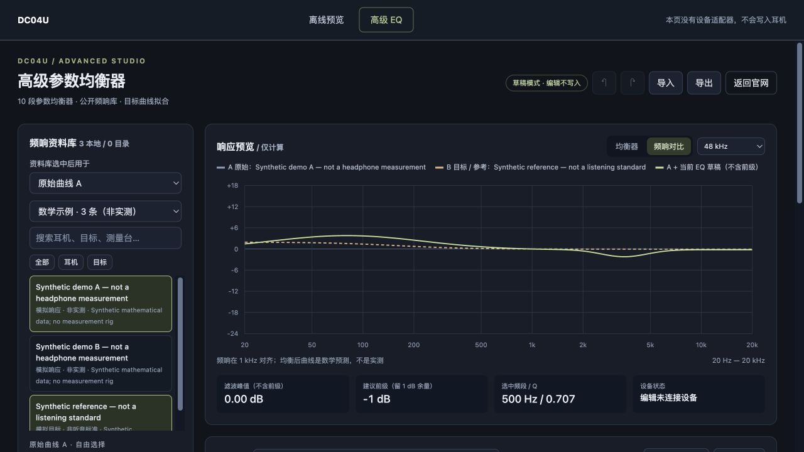

# DC04U Audio Tools

Two practical audio projects in one Chrome extension: **abrupt volume-change protection** and a **ten-band parametric EQ and frequency-response comparison editor** for the [iBasso DC04U control page](https://devices.ibasso.cn/#/device/DC04U).

[中文说明](README.zh-CN.md) · [Architecture](docs/ARCHITECTURE.md) · [Verification](VALIDATION.md) · [Data provenance](data/SOURCES.md)



*The screenshot uses synthetic examples and the hardware-free preview.*

## Project 1 — Volume-change protection

The extension inspects the control page's outgoing WebHID volume commands before they reach a supported DC04U. An upward change **greater than 30 steps** is rejected. Exactly +30 is allowed, downward changes are unrestricted, and there is no fixed volume ceiling.

The comparison tracks a complete interaction, including successive small updates during a drag. A real device report establishes the baseline; reconnecting clears it. The toolbar popup shows whether protection is active and the latest reported volume.

This is protection against a specific class of unintended webpage commands. It does not measure sound pressure or guarantee hearing safety, and does not cover physical buttons, other applications, sudden source audio, gain changes or insertion noise.

## Project 2 — Parametric EQ and curve comparison

- Independently search and select original curve **A** and reference curve **B**, including another headphone measurement; swap them without changing the EQ draft.
- Compare frequency responses aligned at 1 kHz; keep separate measurement groups and identify missing measurement conditions.
- Edit ten filters with frequency, gain and Q controls, draggable points, undo/redo, and precise numeric entry.
- Preview biquad responses at 44.1, 48, 96 and 192 kHz using the published RBJ equations.
- Fit a constrained ten-band EQ draft to a target difference; suggest preamp headroom.
- Import/export frequency-response CSV, native presets, iBasso JSON and supported AutoEq text.
- Keep editing separate from application: device writes require parameter review, a target-slot backup and explicit manual confirmation. Only a matching read-back is reported as verified.

The public repository includes **three clearly labelled synthetic demo curves**. They are mathematical examples, not headphone measurements or listening recommendations. The original local edition used published MOONDROP/HuiHiFi data; the copied third-party datasets are excluded here because no redistribution licence was established. The loader implementation and local-data/import interfaces are retained. See [data/SOURCES.md](data/SOURCES.md).

## Try it without hardware

There are no package dependencies or build steps.

```sh
python3 -m http.server 8769 --bind 127.0.0.1
```

Open `http://127.0.0.1:8769/preview.html`, then choose **高级 EQ**. The preview does not load the device adapter, connect to a DAC or write hardware settings. The interface currently uses Chinese labels.

To compare your own measurements, use **导入** and paste two columns of frequency in Hz and response in dB. Select the A or B destination first. A curve needs at least ten distinct valid frequencies and must span 1 kHz for alignment.

## Install the extension

1. In desktop Chrome, open `chrome://extensions` and enable Developer mode.
2. Choose **Load unpacked** and select this repository's root folder.
3. Reload the official DC04U control page and connect the device through its normal controls.
4. Open **高级 EQ** in the page navigation or use the extension toolbar popup.

The manifest targets only `https://devices.ibasso.cn/*`. Loading or updating the extension requires a page reload because the previously injected hooks remain in an already-open document.

If you deliberately apply an EQ draft, stop playback and remove the headphones first, review and save the target-slot backup, then confirm the device write. The hardware adapter uses the vendor page's existing controller and may need changes when that page changes.

## Tests and validation

Requires Node.js with the built-in test runner, Fetch API and Web Crypto support; Node.js 22 or newer is suitable.

```sh
node --test tests/*.test.cjs
```

The tests exercise the real modules and UI handlers against synthetic data and simulated DOM/HID/controller implementations. They do not connect to hardware or play audio. The original local version passed 145 offline tests; current public-edition results and verification boundaries are recorded in [VALIDATION.md](VALIDATION.md).

## Engineering approach and contribution

This project was developed with an AI coding assistant. The project owner defined the requirements and interaction rules, reported faults, evaluated revisions and guided iterative development. The assistant helped implement code, inspect public documentation and build automated tests. The repository presents the resulting work without claiming that the owner independently wrote every line or trained an AI model.

Development focused on boundary conditions: preventing a drag from bypassing the threshold, establishing a fresh baseline after reconnecting, preserving partial numeric input, isolating asynchronous A/B selections, and distinguishing missing measurement metadata from confirmed mismatches.

No local language model is required at runtime. Calls to a curve-data API are distinct from calls to an AI-model API.

## Implementation limits

The response plot is a mathematical model, not an acoustic measurement. The firmware's exact DSP sample rate, filter implementation and final acoustic response have not been measured. The tool's fitting algorithm uses public equations and is not a reproduction of MOONDROP's proprietary implementation.

Drafts are stored locally in the control site's localStorage. On-demand curve records use IndexedDB caching and requests that omit credentials. No device parameters or drafts are uploaded by the curve loader. The review token prevents accidental stale submissions in the normal interface; it is not a security boundary against a malicious page that already has device access.

The project is independent of iBasso, MOONDROP and HuiHiFi. No project-wide licence has been selected; public visibility alone does not specify a licence grant. Third-party names, documentation and datasets retain their respective ownership.
