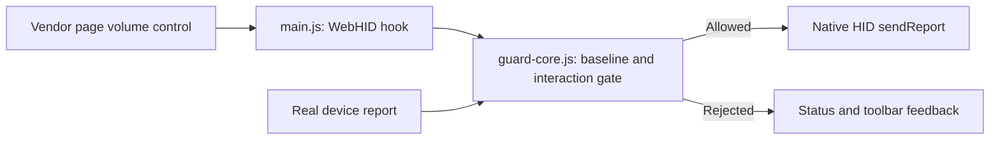
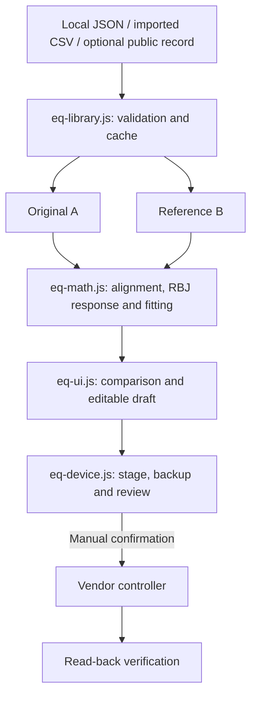

# Architecture

## Volume command path

`guard-core.js` owns parsing, device identity checks, baseline state and threshold decisions. `main.js` installs the page-world hooks and observes interaction boundaries. `bridge.js` relays limited status information to the isolated extension world; `popup.js` renders it. Threshold handling is independent of EQ math and curve selection.

Only supported DC04U device identities and known report shapes are parsed. Reopening a connection invalidates the volume baseline. The core compares the whole gesture or continuous command burst, rather than each individual one-step packet.

## EQ and curve comparison

A and B have independent selection IDs and asynchronous sequence counters. Selecting either side captures its role before a network request starts; a later choice invalidates old responses for that side. Selection changes do not alter EQ bands. Both selected curves and imported points can be persisted with the local draft.

`eq-math.js` is shared between browser and CommonJS tests. It performs logarithmic interpolation, 1 kHz level alignment, filter response calculation, fitting and device quantization. Alignment removes level offsets; it does not make incompatible measurement rigs equivalent.

The device adapter feature-detects the vendor Vue/Pinia stores and controller. Its flow is stage → backup/review → explicit confirmation → write → read-back. Draft revisions invalidate stale review results. The standalone preview omits this adapter entirely.
